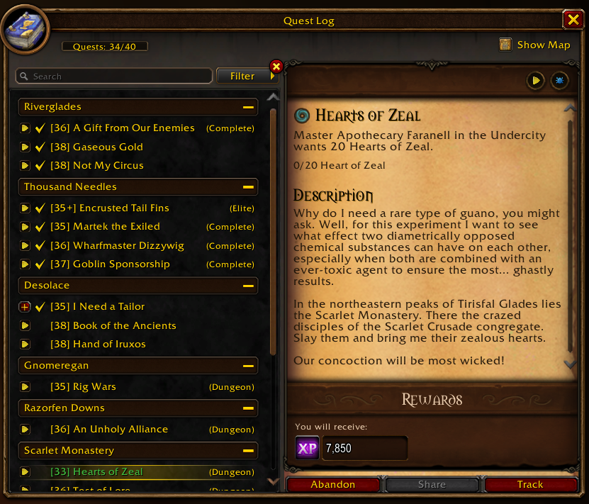

# Classic Quest Log

[](LICENSE)
[](https://github.com/yak3d/wow4e-classic-questlog/releases)
[](https://addons.wago.io/addons/BNBw006x)

This addon remakes the quest log from Classic instead of integrating it into the map. It does add some of the Forever UI assets like the leatherbound rewards panel, bronze bordering etc. You can switch between the single pane and double pane layout.



## Install

Install it with the [Wago app](https://addons.wago.io/addons/BNBw006x), or download `ClassicQuestLog-<version>.zip` from the [releases](https://github.com/yak3d/wow4e-classic-questlog/releases) and unpack it into `World of Warcraft/<flavor>/Interface/AddOns/`.

## Usage

| Command            | Description                             |
| ------------------ | --------------------------------------- |
| `/cql`             | Toggle the quest log window (same as L) |
| `/cql config`      | Open the settings panel                 |
| `/cql toggle`      | Enable or disable the L takeover        |
| `/cql help`        | Show the command list                   |
| `/cql test <verb>` | Developer smoke tests (see below)       |
| `/classicquestlog` | Alias for `/cql`                        |

Developer test verbs: `dump`, `atlases`, `list`, `set <key> <value>`,
`layout double|single`, `select <questID>`, `combat on|off`, `hooks`,
`search <text>`.

## Settings

You can find the settings and their descriptions in Settings → AddOns →
**Classic Quest Log**:

- Replace the quest log (L key)
- Layout: double pane (default) or single pane
- Show quest levels
- Colour quests by difficulty
- Show search box
- Hide the quest panel in the World Map
- Objective tracker clicks open this log

## For addon authors

The log exposes a small public API, `ClassicQuestLogAPI` (`version = 1`), so other addons can decorate it
without reaching into its internals. Forever Quest Tint is the first user.

| Call                    | Returns                                                                  |
| ----------------------- | ------------------------------------------------------------------------ |
| `GetFrame()`            | the window, `ClassicQuestLogFrame`                                       |
| `GetDetailFrame()`      | the quest details pane                                                   |
| `GetDetailParchment()`  | the pane's parchment texture (the world map's quest details atlas)       |
| `GetDetailHeader()`     | the strip along the top of the pane                                      |
| `GetDisplayedQuestID()` | the quest the pane shows; nil when it is empty or the log is closed      |
| `ForEachQuestRow(fn)`   | calls `fn(row, questID, titleFontString)` for each quest row in the list |

Changes are announced through `EventRegistry` (`EventRegistry:RegisterCallback(name, fn, owner)`):

| Event                          | Arguments                       | When                                                     |
| ------------------------------ | ------------------------------- | -------------------------------------------------------- |
| `ClassicQuestLog.DetailShown`  | `questID` or nil                | the pane was filled for a quest, or emptied              |
| `ClassicQuestLog.DetailLayout` | none                            | the rewards panel changed height while the text scrolled |
| `ClassicQuestLog.RowInit`      | `row, questID, titleFontString` | a list row was filled; its title is plain text again     |
| `ClassicQuestLog.WindowHidden` | none                            | the window closed                                        |

The names are also in `ClassicQuestLogAPI.Events`.

## Development

You need [`just`](https://github.com/casey/just), and Git Bash on Windows.
Run `just` to list every recipe and the paths it resolved.

### Install into the game

1. Run `just install`. This symlinks `ClassicQuestLog/` into each flavor
   folder listed in `FLAVORS` (`_forever_ _classic_beta_`) that exists, and
   skips any that don't.
2. After each edit, type `/reload` in game.

The default WoW path covers Windows, macOS, and Linux with Faugus. If your
install is somewhere else, pass the path once and it is saved in `.wow_path`:

```shell
just WOW_DIR="/path/to/World of Warcraft" install
```

To install into one flavor folder only:

```shell
just install _forever_
```

### Uninstall

```shell
just uninstall            # every flavor; or: just uninstall _forever_
just reset                # forget the cached WOW_DIR
```

### Linting

```shell
just lint
```

Runs [luacheck](https://github.com/lunarmodules/luacheck) with the bundled
`.luacheckrc` if it is installed (`luarocks install luacheck`).

### Releasing

Pushing a `v*` tag runs `.github/workflows/addon.yml`. It lints the addon,
builds the zip with the [BigWigs packager](https://github.com/BigWigsMods/packager),
attaches it to a GitHub release and uploads it to
[Wago](https://addons.wago.io/addons/BNBw006x). A tag with `alpha` or `beta`
in it becomes a prerelease.

The Wago upload needs a `WAGO_API_TOKEN` repository secret (an API key from
your Wago account); without it the packager skips Wago and only makes the
GitHub release. The project ID comes from `## X-Wago-ID` in the TOC.

```shell
just release            # asks for the version, tags the latest main, pushes the tag
just release v1.0.0     # or give it up front
```

It fetches, checks the version is new and CI passed on the commit, asks for confirmation, then
tags `origin/main`, pushes the tag and watches the run until the release is up.
